  
   
  
  

 

  

## whoami

I'm MHD — a Linux enthusiast who enjoys building practical tools around **local-first AI, Neovim, and the desktop workflow**.

I like software that gives people control over their own machines: clear setup, useful defaults, and no unnecessary background machinery.

- 🐧 **Daily environment:** Arch Linux + Hyprland
- 🧩 **Interests:** Linux customization, developer tooling, Neovim, local AI, and game environments
- 🛠️ **Currently exploring:** Rust and better ways to make desktop tools feel at home on Linux

## ✦ Featured projects

  
  
  
  
  

  

## ⌁ Toolbox

  
  
  
  
  
  

## ◈ GitHub activity

  
  

---

  Made with curiosity, a terminal, and too many open tabs.
   
  

